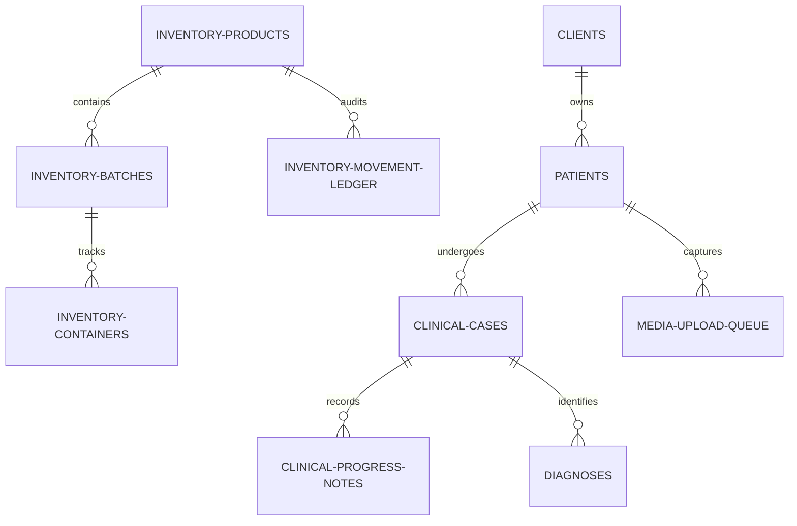
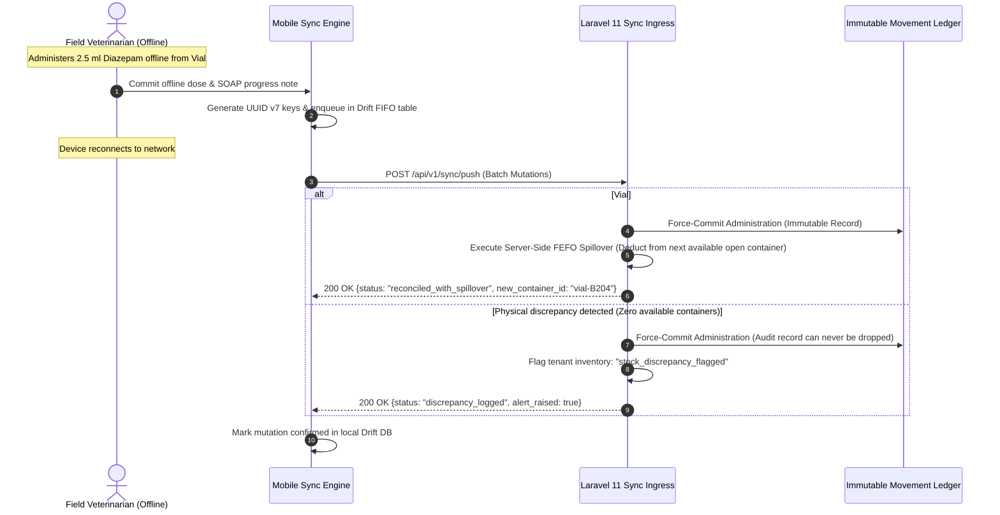

# VetManager Mobile Application Blueprint: Architecture, UI/UX & Store Compliance

## 1. Executive Summary & Design System

The **VetManager Mobile Application** is an enterprise-grade, offline-first client built for veterinary practitioners (Clinic Owners, Head Veterinarians, Associate Doctors, Field/Farm Ambulatory Practitioners, and Veterinary Technicians). It interfaces directly with the VetManager Laravel 11 multi-tenant REST API via isolated tenant connections, Sanctum tokens, and cryptographic UUID v7 idempotency controls.

### 1.1 Cheerful Clinical UI & Micro-Animation System

The mobile application eschews cold, sterile medical UI in favor of a **Warm & Cheerful Clinical Aesthetic** designed to reduce veterinarian stress during high-workload shifts, while retaining high functional clarity.

#### Semantic Color Palette (`lib/app/theme/app_colors.dart`)
| Token Name | Hex Code | Visual Role |
| :--- | :--- | :--- |
| `backgroundCream` | `#FAF8F5` | Primary warm background across all screens (replaces stark white) |
| `surfaceWhite` | `#FFFFFF` | Card & sheet container background with subtle warm border |
| `primaryEmerald` | `#0D9488` | Main branding, primary action buttons, active navigation states |
| `secondaryCoral` | `#FF7E67` | Warm secondary accents, FAB buttons, high-priority highlights |
| `badgeStableMint` | `#D1FAE5` | Status pill: Discharged, Stable Patient, Normal Vitals, Sealed Container |
| `badgeObsAmber` | `#FEF3C7` | Status pill: Under Observation, Pending Tests, Open Container |
| `badgeCriticalRose`| `#FFE4E6` | Status pill: Critical Triage, Emergency, Drug Waste, Suspended |
| `textCharcoal` | `#1E293B` | High-contrast body text (WCAG AAA compliant) |
| `textMuted` | `#64748B` | Subheadings, timestamps, secondary labels |

#### Mandatory Micro-Animations & Fluid Transitions
1. **Staggered Slide-and-Fade Entry (`flutter_animate`)**:
   - Dashboard cards, patient list tiles, and triage rows enter with staggered delay: `.animate().fadeIn(duration: 250.ms).slideY(begin: 0.08, end: 0, curve: Curves.easeOutQuad)`.
2. **Hero Container Transforms (`animations` package)**:
   - Tapping any Patient Card or Case Card utilizes `OpenContainer` (Material Motion) to seamlessly morph the list tile into the Patient/Case Detail screen without jarring route flashes.
3. **Blurred Backdrop Spring Bottom Sheets**:
   - Quick actions, witness PIN pads, and dosage sliders expand over a `BackdropFilter` with `ImageFilter.blur(sigmaX: 8, sigmaY: 8)` and an elastic spring curve: `CurvedAnimation(parent: controller, curve: Curves.easeOutBack)`.

---

## 2. Local Drift Relational Database (`lib/database/`)

The local offline database utilizes **Drift (SQLite)** to guarantee offline operability during rural ambulatory farm calls and metal hospital X-ray rooms.



### 2.1 4-Tier Pharmacy & Inventory Schema (`lib/database/tables/`)
1. **`inventory_products_table.dart`**:
   - Product master record (`id`, `sku`, `name`, `base_unit` [ml, mg, tablet], `is_controlled`, `controlled_schedule` [II-V], `min_threshold`).
2. **`inventory_batches_table.dart`**:
   - Batch/Lot tracking (`id`, `product_id`, `lot_number`, `expires_at`, `unit_cost`, `initial_base_qty`, `remaining_base_qty`). Enforces FEFO (First-Expired, First-Out) sorting.
3. **`inventory_containers_table.dart`**:
   - Physical container/vial tracker (`id`, `batch_id`, `barcode`, `initial_volume`, `remaining_balance`, `status` [sealed, open, depleted], `opened_at`, `opened_by_user_id`).
4. **`inventory_movement_ledger_table.dart`**:
   - Immutable audit log (`id`, `product_id`, `batch_id`, `container_id`, `movement_type` [received, consumed, wasted, reversal_void], `quantity`, `balance_after`, `idempotency_key`, `recorded_by_user_id`, `witnessed_by_user_id`, `created_at`).

### 2.2 Clinical Care & Medical Tables
1. **`clients_table.dart`**:
   - Owners & farms (`id`, `name`, `phone_primary`, `phone_secondary`, `client_type` [individual, breeder, farm], `physical_address`).
2. **`patients_table.dart`**:
   - Animals (`id`, `client_id`, `name_or_tag`, `species`, `breed`, `gender`, `date_of_birth`, `microchip_number`, `ear_tag_id`, `current_weight_kg`, `allergies`).
3. **`clinical_cases_table.dart`**:
   - Active & historical cases (`id`, `case_number`, `patient_id`, `primary_vet_id`, `case_type`, `status` [open, in_progress, closed], `priority` [routine, urgent, critical], `chief_complaint`, `admitted_at`, `discharged_at`).
4. **`clinical_progress_notes_table.dart`**:
   - SOAP examination logs (`id`, `case_id`, `vet_id`, `subjective_notes`, `objective_vitals` [temp_c, heart_rate_bpm, resp_rate, mucous_membrane, crt_sec], `assessment_notes`, `plan_notes`, `is_signed`, `signed_at`, `addendum_to_id`).
5. **`diagnoses_table.dart`**:
   - Diagnostic entries (`id`, `case_id`, `patient_id`, `user_id`, `diagnosis_name`, `status` [preliminary, confirmed, ruled_out], `diagnosed_at`).
6. **`media_upload_queue_table.dart`**:
   - Offline media staging (`id`, `case_id`, `patient_id`, `local_file_path`, `mime_type`, `file_size_bytes`, `upload_status` [pending, presigned, uploaded, confirmed], `r2_object_key`, `created_at`). Staged WebP photos captured in rural areas wait here until connectivity resumes.
7. **`sync_queue_table.dart`**:
   - Deterministic FIFO sync queue (`id`, `entity_type`, `mutation_type`, `payload_json`, `idempotency_key`, `client_created_at`, `retry_count`, `last_error`).

---

## 3. Sync Engine: Force-Reconcile & Immutable Append-Only Protocol

Ambulatory veterinary work cannot afford network-blocking rejections. In `lib/sync/conflict_resolver.dart`, traditional Last-Write-Wins (LWW) is replaced by our **Force-Reconcile Protocol**:



### Core Sync Invariants:
1. **Never Drop Clinical Records**: An administered drug or recorded vital sign physically occurred. The sync engine will **never discard or roll back** an administered dose or signed SOAP note due to a server version collision.
2. **Automatic FEFO Spillover**: If the physical container recorded on mobile was closed or depleted on the server during offline hours, the server automatically attributes the deduction to the next available batch/container in line.
3. **Discrepancy Flagging**: If tenant inventory reaches negative balances due to offline physical usage, the transaction still commits, and a high-priority `stock_discrepancy_flagged` notification is delivered to the Clinic Owner.

---

## 4. Complete Directory & File Blueprint

```
vet_manager_mobile/
├── android/
│   ├── app/
│   │   ├── build.gradle.kts                 # targetSdk = 35, 16KB page alignment
│   │   └── src/main/AndroidManifest.xml
├── ios/
│   ├── Runner/
│   │   ├── Info.plist
│   │   └── PrivacyInfo.xcprivacy             # Apple Required-Reason APIs
├── test/
│   ├── features/
│   ├── database/
│   └── sync/
├── lib/
│   ├── main.dart                             # Global DI bootstrap & offline DB init
│   │
│   ├── app/                                  # App Configuration Layer
│   │   ├── app.dart                          # MaterialApp.router configuration
│   │   ├── router/
│   │   │   ├── app_router.dart               # GoRouter with tenant & role route guards
│   │   │   └── route_names.dart              # Type-safe route paths
│   │   ├── theme/
│   │   │   ├── app_colors.dart               # Warm Cream, Emerald, Coral, Pastel Badges
│   │   │   ├── app_theme.dart                # Light & Dark theme definitions
│   │   │   └── text_styles.dart              # GoogleFonts (Plus Jakarta Sans) typography
│   │   └── observer/
│   │       └── app_bloc_observer.dart        # Global BLoC state logger & Crashlytics
│   │
│   ├── core/                                 # Cross-Cutting Infrastructure
│   │   ├── constants/
│   │   │   ├── api_endpoints.dart            # REST API endpoints
│   │   │   └── storage_keys.dart             # Secure storage keys
│   │   ├── error/
│   │   │   ├── exceptions.dart               # Server, Network, PinAuth exceptions
│   │   │   └── failures.dart                 # Functional Result failure objects
│   │   ├── network/
│   │   │   ├── api_client.dart               # Configured Dio client
│   │   │   ├── tenant_interceptor.dart       # Dynamic X-Tenant-ID & Bearer token injection
│   │   │   ├── idempotency_interceptor.dart  # Injects UUID v7 Idempotency-Key
│   │   │   └── error_interceptor.dart        # Handles 401, 403, 409 conflict retries
│   │   ├── storage/
│   │   │   ├── secure_storage_service.dart   # Keychain / EncryptedSharedPreferences
│   │   │   └── local_cache_service.dart      # Non-sensitive preferences
│   │   ├── utils/
│   │   │   ├── uuid_generator.dart           # RFC 9562 UUID v7 generator
│   │   │   ├── date_formatter.dart           # Clinical UTC / local formatters
│   │   │   └── decimal_calculator.dart       # High-precision stock/weight math
│   │   └── widgets/                          # Shared UI & Micro-Animation Primitives
│   │       ├── adaptive_scaffold.dart        # Responsive NavRail (Tablet) / BottomBar
│   │       ├── animated_pressable.dart       # Spring scale tap feedback (0.97 scale on tap)
│   │       ├── blurred_bottom_sheet.dart     # BackdropFilter blur + spring entry sheet
│   │       ├── triage_priority_badge.dart    # Mint, Amber, Rose pill chips
│   │       ├── animal_species_avatar.dart    # Dog, Cat, Equine, Bovine SVG icons
│   │       └── offline_status_banner.dart    # Auto-animating network status indicator
│   │
│   ├── database/                             # Drift SQLite Relational Persistence
│   │   ├── app_database.dart                 # Main Drift database class
│   │   ├── app_database.g.dart               # Generated schema & query code
│   │   ├── tables/
│   │   │   ├── inventory_products_table.dart
│   │   │   ├── inventory_batches_table.dart
│   │   │   ├── inventory_containers_table.dart
│   │   │   ├── inventory_movement_ledger_table.dart
│   │   │   ├── clients_table.dart
│   │   │   ├── patients_table.dart
│   │   │   ├── clinical_cases_table.dart
│   │   │   ├── clinical_progress_notes_table.dart
│   │   │   ├── diagnoses_table.dart
│   │   │   ├── media_upload_queue_table.dart
│   │   │   └── sync_queue_table.dart
│   │   └── daos/
│   │       ├── inventory_dao.dart
│   │       ├── client_patient_dao.dart
│   │       ├── clinical_case_dao.dart
│   │       ├── media_queue_dao.dart
│   │       └── sync_queue_dao.dart
│   │
│   ├── sync/                                 # Delta Synchronization Engine
│   │   ├── sync_manager.dart                 # Network connectivity listener & trigger
│   │   ├── sync_queue_dispatcher.dart        # Flushes FIFO queue to POST /api/v1/sync/push
│   │   ├── sync_pull_service.dart            # Ingests deltas from GET /api/v1/sync/pull
│   │   └── conflict_resolver.dart            # Force-Reconcile & Append-Only protocol
│   │
│   └── features/                             # Modular Domain Features
│       │
│       ├── auth/                             # Two-Step Smart Login & Session
│       │   ├── data/
│       │   │   ├── datasources/auth_remote_datasource.dart
│       │   │   ├── models/tenant_discovery_model.dart
│       │   │   └── repositories/auth_repository_impl.dart
│       │   ├── domain/
│       │   │   ├── entities/user_entity.dart
│       │   │   ├── entities/tenant_entity.dart
│       │   │   └── usecases/login_usecase.dart
│       │   └── presentation/
│       │       ├── bloc/auth_bloc.dart
│       │       ├── screens/smart_login_screen.dart   # Step 1: Email -> Staggered Clinic Cards -> Step 2: Password
│       │       └── screens/biometric_unlock_screen.dart # FaceID / Fingerprint session unlock
│       │
│       ├── dashboard/                        # Role-Adaptive Home Screen
│       │   ├── presentation/
│       │   │   ├── bloc/role_navigation_cubit.dart
│       │   │   ├── screens/clinic_owner_dashboard.dart
│       │   │   ├── screens/field_doctor_dashboard.dart
│       │   │   └── widgets/staggered_metric_card.dart # flutter_animate card entry
│       │
│       ├── staff_profile/                    # Doctor Directory & Clinic Staff Management
│       │   ├── data/
│       │   │   ├── datasources/staff_remote_datasource.dart
│       │   │   └── repositories/staff_repository_impl.dart
│       │   ├── domain/
│       │   │   ├── entities/staff_entity.dart
│       │   │   ├── entities/vet_profile_entity.dart
│       │   │   ├── usecases/toggle_availability_usecase.dart
│       │   │   └── usecases/create_staff_usecase.dart
│       │   └── presentation/
│       │       ├── bloc/staff_bloc.dart
│       │       ├── screens/doctor_profile_screen.dart # License, DEA, specialty, active cases count, is_available switch
│       │       └── screens/staff_management_screen.dart # Owner CRUD: Add staff, set roles, assign 4-digit PINs
│       │
│       ├── clients_patients/                 # Owners & Animal Profiles
│       │   ├── data/
│       │   │   ├── datasources/patient_local_datasource.dart
│       │   │   ├── datasources/patient_remote_datasource.dart
│       │   │   └── repositories/patient_repository_impl.dart
│       │   ├── domain/
│       │   │   ├── entities/client_entity.dart
│       │   │   ├── entities/patient_entity.dart
│       │   │   └── usecases/search_patients_usecase.dart
│       │   └── presentation/
│       │       ├── bloc/patient_list_bloc.dart
│       │       ├── screens/patient_list_screen.dart
│       │       ├── screens/patient_detail_screen.dart # OpenContainer hero transition destination
│       │       └── widgets/patient_card.dart          # OpenContainer source tile
│       │
│       ├── clinical_cases/                   # SOAP Notes, Diagnoses & Case Studies
│       │   ├── data/
│       │   │   ├── datasources/case_local_datasource.dart
│       │   │   ├── datasources/case_remote_datasource.dart
│       │   │   └── repositories/case_repository_impl.dart
│       │   ├── domain/
│       │   │   ├── entities/case_entity.dart
│       │   │   ├── entities/progress_note_entity.dart
│       │   │   └── usecases/export_case_pdf_usecase.dart
│       │   └── presentation/
│       │       ├── bloc/case_detail_bloc.dart
│       │       ├── screens/cases_board_screen.dart
│       │       ├── screens/case_detail_screen.dart
│       │       ├── widgets/soap_notes_view.dart       # Subjective, Objective, Assessment, Plan
│       │       ├── widgets/create_addendum_dialog.dart # Immutable signed note addendum
│       │       └── widgets/export_case_study_pdf_sheet.dart # PDF preview via printing package with anonymize_owner toggle
│       │
│       ├── inventory_doses/                  # Fractional Dosing & Controlled Substances
│       │   ├── data/
│       │   │   ├── datasources/inventory_local_datasource.dart
│       │   │   └── repositories/inventory_repository_impl.dart
│       │   ├── domain/
│       │   │   ├── entities/vial_container_entity.dart
│       │   │   └── usecases/administer_dose_usecase.dart
│       │   └── presentation/
│       │       ├── bloc/dose_administration_bloc.dart
│       │       ├── screens/administer_dose_screen.dart
│       │       ├── widgets/witness_pin_bottom_sheet.dart # Blurred modal for 4-digit supervisor PIN
│       │       └── widgets/void_dose_bottom_sheet.dart    # Ledger reversal & reason logging
│       │
│       ├── media/                            # Direct-to-R2 Cloud Uploads
│       │   ├── data/
│       │   │   ├── datasources/media_remote_datasource.dart
│       │   │   └── services/r2_direct_uploader.dart
│       │   ├── domain/
│       │   │   └── usecases/upload_clinical_photo_usecase.dart
│       │   └── presentation/
│       │       ├── bloc/media_upload_bloc.dart
│       │       ├── screens/photo_viewer_screen.dart   # Interactive pinch-to-zoom
│       │       └── widgets/camera_capture_sheet.dart  # Pre-compression to WebP
│       │
│       └── settings/                         # App Preferences & Store Compliance
│           └── presentation/
│               ├── screens/settings_screen.dart
│               ├── screens/privacy_policy_screen.dart
│               ├── screens/medical_disclaimer_screen.dart # Guideline 1.4.1 compliance
│               └── screens/delete_account_screen.dart     # Guideline 5.1.1(v) account deletion
```

---

## 5. UI/UX Interaction Walkthroughs

### 5.1 Smart Two-Step Login Flow (`smart_login_screen.dart`)
1. **Step 1 (Discovery)**: User enters their email address. App queries `POST /api/v1/auth/resolve-tenants`.
2. **Animation**: If the user belongs to multiple clinics, clinic selector cards slide in with staggered fade (`flutter_animate`).
3. **Step 2 (Ingress)**: Selecting a clinic reveals the Password / PIN entry field with the clinic's logo and tenant slug badge.
4. **Token Minting**: Successful login securely stores the Sanctum token and binds the active `tenant_id` to Keychain.

### 5.2 Controlled Substance Witness Modal (`witness_pin_bottom_sheet.dart`)
1. When administering a Schedule II–V drug (e.g. Ketamine, Butorphanol), the app intercepts submission.
2. An elastic bottom sheet springs up over a blurred background (`BackdropFilter` sigma 8).
3. The supervisor doctor enters their **4-digit PIN**.
4. The app verifies the PIN via local encrypted cache (if offline) or `POST /api/v1/auth/verify-pin` (if online).
5. The witness's user UUID is permanently embedded into the `inventory_movement_ledger` row before committing.

### 5.3 Case Study PDF Export (`export_case_study_pdf_sheet.dart`)
1. Attending veterinarian clicks "Export Case Study" on any clinical case.
2. A bottom sheet displays a live PDF preview using the `printing` package.
3. Doctor toggles **"Anonymize Owner & Pet Names"** switch:
   - When enabled, Owner Name is redacted to `[REDACTED]`, Pet Name is replaced by `Canine Patient (Microchip #...849)`, and clinic contact is preserved.
4. Native print, AirPrint, or share sheet triggers instantly.

---

## 6. Production `pubspec.yaml` Specification

```yaml
name: vet_manager_mobile
description: Enterprise Clinical Veterinary Mobile Client
publish_to: "none"
version: 1.0.0+1

environment:
  sdk: ">=3.5.0 <4.0.0"
  flutter: ">=3.24.0"

dependencies:
  flutter:
    sdk: flutter
  flutter_localizations:
    sdk: flutter

  # UI Design, Typography & Micro-Animations
  google_fonts: ^6.2.1
  flutter_animate: ^4.5.0
  animations: ^2.0.11
  flutter_svg: ^2.0.10+1

  # State Management & DI
  flutter_bloc: ^8.1.6
  equatable: ^2.0.5
  get_it: ^7.7.0
  injectable: ^2.4.2

  # Routing
  go_router: ^14.2.7

  # Networking & Serialization
  dio: ^5.7.0
  json_annotation: ^4.9.0
  connectivity_plus: ^6.0.5

  # Local Persistence & Relational Schema (Drift)
  drift: ^2.20.0
  sqlite3_flutter_libs: ^0.5.24 # 16KB Android 15 page size compatible
  path_provider: ^2.1.4
  path: ^1.9.0

  # Hardware Security & Biometrics
  flutter_secure_storage: ^9.2.2
  local_auth: ^2.2.0

  # Identifiers & Arithmetic
  uuid: ^4.5.1 # RFC 9562 UUID v7
  decimal: ^3.0.2 # Zero floating-point rounding errors
  intl: ^0.19.0

  # Media, Camera & Documents
  image_picker: ^1.1.2 # Modern Google Photo Picker (Zero broad storage permissions)
  flutter_image_compress: ^2.3.0 # Client-side WebP compression
  photo_view: ^0.15.0 # High-resolution radiograph zoom
  cached_network_image: ^3.4.0
  printing: ^5.13.2 # Native PDF case study rendering & export
  pdf: ^3.11.1

dev_dependencies:
  flutter_test:
    sdk: flutter
  flutter_lints: ^4.0.0
  build_runner: ^2.4.12
  json_serializable: ^6.8.0
  injectable_generator: ^2.6.1
  drift_dev: ^2.20.0
  bloc_test: ^9.1.7
  mocktail: ^1.0.4
  flutter_launcher_icons: ^0.13.1
  flutter_native_splash: ^2.4.1
```

---

## 7. App Store & Google Play Launch Checklist

| Platform | Guideline / Requirement | Implementation Detail | Status |
| :--- | :--- | :--- | :--- |
| **Apple App Store** | **Guideline 1.4.1** (Medical Software) | Prominent veterinary clinician disclaimer in `medical_disclaimer_screen.dart` | Built-in |
| **Apple App Store** | **Guideline 5.1.1(v)** (Account Deletion) | In-app self-service account deletion in `delete_account_screen.dart` | Built-in |
| **Apple App Store** | **Guideline 5.1.1** (Privacy Manifest) | `PrivacyInfo.xcprivacy` declaring `NSPrivacyAccessedAPITypeUserDefaults` | Built-in |
| **Apple App Store** | **Guideline 3.1.3(c)** (B2B SaaS Exemption)| B2B multi-tenant enterprise portal; zero in-app links to web billing tiers | Built-in |
| **Google Play** | **Target SDK 34 / 35+** | Compiled with `targetSdk = 35` and edge-to-edge window insets | Configured |
| **Google Play** | **16 KB Memory Page Size** | Linked with `sqlite3_flutter_libs` compiled for 16KB alignment | Configured |
| **Google Play** | **Photo Picker Access** | Uses system photo picker without requesting `READ_MEDIA_IMAGES` | Configured |
| **Google Play** | **Data Safety Section** | Discloses TLS 1.3 transit encryption and local encrypted patient storage | Configured |

---

## 8. Automated Testing Architecture & Invariants

VetManager Mobile enforces a strict **Zero-Untested-Code** policy. Every feature added to the application must be verified by automated tests across the following layers:

1. **Database Persistence Layer (`test/database/`)**:
   - In-memory SQLite tests validating foreign key cascades, tenant boundaries, atomic transactions, and custom type conversions.
   - Clinical sorting validation (e.g., triage urgency priority, FEFO batch lot ordering, and open-vial priority).
2. **BLoC & State Machines (`test/features/*/presentation/bloc/`)**:
   - Event-driven state transition tests using `bloc_test`.
   - Error states, network failure recovery, and loading transitions.
3. **Domain & Business Logic (`test/features/*/domain/`)**:
   - Use cases and precision mathematical computations (dosages, drug waste, conversions).
4. **Networking & Sync (`test/sync/`, `test/core/network/`)**:
   - HTTP interceptor tests, tenant header attachment, UUID v7 idempotency verification, and conflict reconciliation simulations.
5. **Widget & Presentation Layer (`test/features/*/presentation/`)**:
   - Widget tests validating responsive layout, text input controllers, modal dialogs, and species avatar chips.
